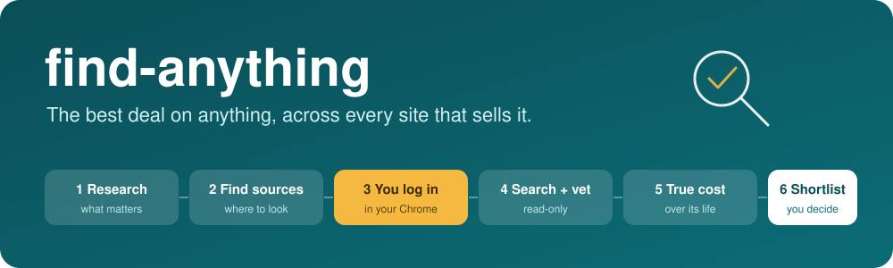

<p align="center"></p>

<p align="center"><a href="https://kancess.github.io/find-anything/"><b>Website</b></a> · <a href="#quick-start">Quick start</a> · <a href="CONTRIBUTING.md">Contribute</a></p>

**Find the best good-and-cheap deal on anything**: a washing machine, a bike, a laptop, a used car. It runs in [Claude Code](https://claude.com/claude-code) through **your own Chrome**, researches the category, finds where it's sold near you, asks you for a login only if a site needs one, and hands you a ranked shortlist with the **true cost**, not just the price. You approve every message it sends.

> [!NOTE]
> Early pilot. It grew out of a real search, so one category (used cars) is already mapped as a **domain pack**. Everything else uses the generic `find-anything` skill, and any hunt can become a new pack.

## How it works


| The agent does | You do |
|---|---|
| Researches, searches, reads listings, vets, costs, ranks | Log in, solve CAPTCHAs, make the calls |
| Drafts the exact message | Approves it (nothing is sent without that) |
| Stops and asks when stuck, never skips or bypasses | Inspects, pays, owns the decision |

## Quick start

**Needs:** Claude Code, the **Claude in Chrome** extension, Chrome. No API keys.

```text
/plugin marketplace add Kancess/find-anything
/plugin install find-anything@find-anything
```

Then just say what you want:

> *Use find-anything to help me buy a washing machine. I'm in Perth, up to $900, front loader, household of four.*

> *Use find-anything to find a second-hand road bike in Melbourne, up to $1,500, for a 15 km commute.*

<details>
<summary>Prefer to clone? Want a ready-made pack?</summary>

```bash
git clone https://github.com/Kancess/find-anything.git && cd find-anything && claude
```
All skills load from `.claude/skills`.

Domain packs add category-specific skills and data. Install one with `/plugin install <pack>@find-anything`; see the table below.
</details>

## What you get

| | |
|---|---|
| **Category card** | what matters for *this* thing, typical prices, problem areas, hidden costs, local consumer rules, each with its source |
| **Source plan** | where to look in your location, and which sites need you to log in |
| **Ranked shortlist** | links, prices, flags, a clear recommendation and a runner-up |
| **True cost** | price + delivery, running costs, repairs, minus resale, plus a "do you need to buy at all" check |
| **Honest gaps** | what was and wasn't searched, and what needs you |

Results are saved locally under `searches/` (gitignored). Ask for the optional one-page HTML report, and keep it private if it shows your finances.

## Categories

| Category | Status | Docs |
|---|---|---|
| Used cars | mapped and tested | [`plugins/find-cars`](plugins/find-cars/README.md) |
| Anything else | works from scratch | skill `find-anything` |

Good hunt in a new category? [Turn it into a domain pack](plugins/find-anything/domains/README.md) so the next person starts faster.

> [!IMPORTANT]
> **Responsible use.** It drives your own browser to read public listings you could view yourself: sequential, light, read-only, no bulk crawling. Many sites restrict automated access (social networks especially, so those are opt-in only): **you** are responsible for complying with their terms. It never bypasses CAPTCHAs or logins, never creates accounts, never pays. Not financial, legal, safety or mechanical advice; always check history and inspect before buying. [Full notice below.](#responsible-use-full-notice)

<details>
<summary>Update and troubleshoot</summary>

**Update:** `/plugin marketplace update find-anything`, then update the plugins you installed from the `/plugin` menu. Clone users: `git pull`. Your `searches/` are never touched.

**Troubleshooting**
- *Plugin won't install* (no SSH key): `/plugin marketplace add https://github.com/Kancess/find-anything.git`
- *Browser tools missing:* install Claude in Chrome, keep Chrome open and connected, re-run.
- *CAPTCHA, login or block page:* expected. Handle it in your Chrome and say "done".
- *Few or odd results:* say what you expected to see; it can re-run narrower queries. Sites change, so site notes in a domain pack may need updating (PRs welcome).
- *Search results look thin or foreign:* web search can be weak for local queries. The agent flags what it couldn't confirm; treat those as leads.
</details>

<details>
<summary>Repository layout</summary>

```text
.claude-plugin/marketplace.json     lists the plugins
plugins/
  find-anything/                    CORE (any category)
    skills/find-anything|source-discovery
    docs/                           collaboration protocol, browsing rules
    domains/                        how packs work + template
  find-cars/                        used-cars domain pack (works on its own)
    (its own skills, site notes, data, examples: see its README)
scripts/sync-shared-docs.sh         keeps each plugin's copy of shared docs in sync
searches/                           YOUR searches (gitignored)
```
Each plugin is self-contained, so a pack carries its own copy of the shared docs.
</details>

<details>
<summary>Principles and known limits</summary>

- **Human + agent teamwork.** The agent does the legwork; you hold logins, CAPTCHAs, decisions, approvals and money. See [`collaboration.md`](plugins/find-anything/docs/collaboration.md).
- **You stay in control.** No login, payment, message or offer without your approval of the exact action.
- **Diplomatic, not desperate.** Seller messages never reveal your budget, urgency or any deadline.
- **Honest about uncertainty.** Nothing is inspected. Run a history check and get an independent inspection.
- **Rules are data**, with sources and a `verified` date. Fees and rules change; re-verify.

**Known limits:** sites change markup and block automation, so site notes need upkeep; the generic flow's browser sweep for categories without a pack is still being proven; category-specific limits live in each pack's README.
</details>

<details id="responsible-use-full-notice">
<summary>Responsible use: full notice</summary>

This tool drives **your own browser, with your own sessions**, to read public listings you could view yourself. It is a personal research assistant, not a data-collection service.
- **Check each site's terms of use.** Many marketplaces restrict automated access, and some are strict (social networks such as Facebook especially). You are responsible for complying with the terms of any site you use it on and for any consequences, such as being blocked or banned. Sites with strict terms are **off by default** and opt-in only.
- **Read-only and light-touch.** The skills search a handful of narrow queries sequentially, look at the top results, and stop. They are not meant for bulk crawling, monitoring at scale, resale of data, or republishing listings. They never bypass CAPTCHAs, bot checks or logins: if a site needs one, they stop, ask you to handle it in your own browser, keep working on everything else, and carry on when you say done.
- **No data hoarding.** Only the shortlist you asked for is saved, locally in `searches/`. Don't publish other people's listings, photos or contact details.
- **Not advice.** Nothing here is financial, legal, safety, mechanical or consumer-law advice, and results can be wrong.
- Not affiliated with, endorsed by, or sponsored by any marketplace named in the docs; names only describe what a source is.
- Provided "as is" under the MIT licence, without warranty.
</details>

## Roadmap

More domain packs from real hunts (appliances, bikes, laptops, furniture, rentals) · more sources and regions · saved searches with alerts for new below-market listings · per-category reliability notes with cited sources · a lightweight web UI.

## Licence

[MIT](LICENSE) © 2026 Kancess. Use it, change it, share it, including commercially; keep the licence notice with copies (each plugin folder carries its own copy of [`LICENSE`](LICENSE) so installed copies do too). Provided "as is", without warranty.

- **Independent project.** find-anything is not made, endorsed or sponsored by Anthropic, Google or any marketplace it can search. "Claude" and "Claude Code" are trademarks of Anthropic; other names belong to their owners and are used only to say what a source or product is.
- **Third-party code on the website.** The Pages site (`docs/`) loads [GSAP](https://gsap.com/standard-license/) (GreenSock standard licence) and [Lenis](https://github.com/darkroomengineering/lenis) (MIT) from a CDN, and fonts from Google Fonts (open font licences). They are not bundled into this repo and keep their own licences.
- **Data and examples.** Rules in `plugins/find-cars/data/` summarise public government sources, cited in each file; verify before relying on them. Examples are anonymised snapshots; don't republish other people's listings or photos.
- **Contributions** are accepted under the same MIT licence (see [`CONTRIBUTING.md`](CONTRIBUTING.md)).
